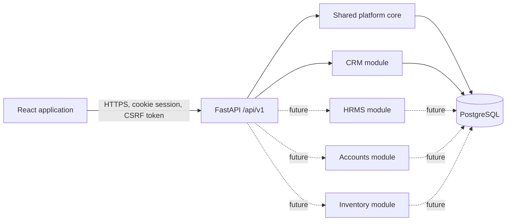
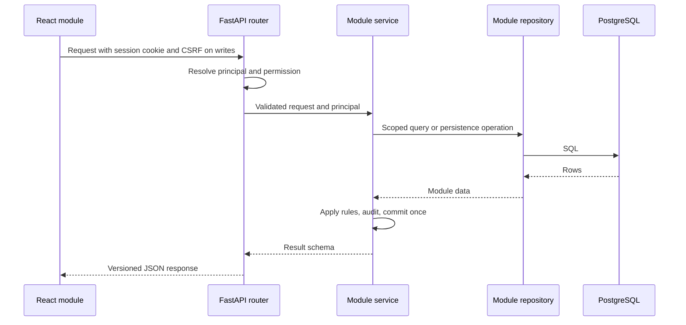

# ERP Backend Architecture

## Purpose

This backend is a modular monolith: one FastAPI deployment and one PostgreSQL database, with clear ownership boundaries between the shared platform and business modules. CRM is the first business module. HRMS, Accounts, and Inventory can be added without placing their routes, rules, or tables in the shared core.

The attached platform architecture document is the product and domain reference. This file defines how that design maps to the current backend and the rules new backend work must follow.

## Platform shape



Keep this as one deployable application while the modules share the same release and operational lifecycle. Do not split services just to create directory boundaries. A module can be separated later when it needs independent scaling, deployment, or ownership.

## Backend structure

```text
crm-backend/
  app/
    main.py                     # FastAPI setup, middleware, lifecycle, health
    api.py                      # explicit versioned router assembly
    models.py                   # app-level SQLAlchemy model registration for Alembic
    core/                       # settings, database, base models, security, errors
    shared/                     # platform capabilities used by multiple modules
      auth/                     # session login, CSRF, current principal
      users/                    # people, departments, organization membership
      rbac/                     # permission registry, roles, scope helpers
      audit/                    # audit writer and audit API
      files/                    # later: storage contract, uploads and downloads
      notifications/            # later: notification service and delivery adapters
      events/                   # later: event envelope and in-process dispatcher
    modules/
      crm/
        router.py               # HTTP endpoints only
        schemas.py              # request and response contracts
        service.py              # CRM use cases and business rules
        repository.py           # CRM-owned SQL queries
        models.py               # CRM-owned tables
        permissions.py          # CRM permission declarations
        events.py               # CRM event declarations and handlers
      hrms/                     # same module contract when started
      accounts/
      inventory/
    scripts/                    # operational commands such as seed and cleanup
  alembic/                      # one migration history for the deployable database
    versions/
  tests/
    shared/
    modules/
```

The existing `shared/users` module owns both users and departments because departments describe the organization used by user assignment and access rules. Keep that relationship there unless a later domain decision makes departments an independent business capability.

## Dependency and layer rules

```text
router -> service -> repository -> model
                  -> shared service interfaces
```

- **Router:** translates HTTP input and output, applies authentication and permission dependencies, and calls one service use case. It must not contain SQL, business rules, or multi-step writes.
- **Schema:** validates API input and controls output fields. Do not return ORM models without an explicit response schema.
- **Service:** owns business rules, authorization-sensitive decisions, transaction boundaries, and audit/event intent. A write use case commits once after all related writes are ready; repositories never commit.
- **Repository:** owns queries and persistence for its module. It returns that module's models or read shapes. Repositories do not call other modules.
- **Model:** owns table definition and local relationships. It does not import another business module's model.
- **Permission declaration:** defines module-specific permission codes. The shared permission registry imports or registers those declarations for seed and validation.

Import direction is one-way: business modules may depend on `core` and `shared`; `shared` never imports business modules. CRM must not import HRMS models or services, and vice versa. Cross-module work uses a small public service interface or a domain event, not another module's repository or internal model.

For work that must happen after a database commit, persist an outbox event in the same transaction before introducing a network queue. A handler can be moved to Redis or another broker later without changing the business use case.

## API and router assembly

- All application endpoints stay under `/api/v1`.
- `app/api.py` explicitly includes shared routers and each business module router. This is the only place that assembles the public API.
- Shared endpoints keep their stable paths: `/auth`, `/users`, `/departments`, `/roles`, and `/audit-logs`.
- Business endpoints use `/<module>/<resource>`, for example `/crm/leads` and later `/hrms/employees`.
- Keep request and response shapes in OpenAPI. The frontend consumes that contract; a route is not considered integrated until its permissions and response shape are defined.
- Use a consistent error body: `{ "code", "message", "details" }`.

Do not add an automatic plugin scanner for modules. Explicit imports make startup behavior, route ownership, and missing registration easy to review.

## Data ownership and migrations

Adopt one PostgreSQL schema per platform area: `shared`, `crm`, `hrms`, `accounts`, and `inventory`. One PostgreSQL database and one Alembic history remain the deployment boundary. Each migration must identify the owning module in its filename and review notes. Do not create separate Alembic histories for modules in the same deployable app.

The current first migration places tables in PostgreSQL's default schema. Before adding the first CRM business tables, write and review a data-preserving Alembic migration that creates `shared` and moves the existing platform tables into it. Set explicit SQLAlchemy schema ownership for new shared and business models. Do not create CRM tables until this boundary is settled; do not silently mix default-schema and module-schema tables.

Rules for tables:

- A module owns its tables, migrations, repositories, and retention rules.
- Keep relationships within a module's schema where practical.
- Cross-module records store the other module's UUID and call its service interface. Avoid cross-module foreign keys; shared identity foreign keys are allowed where they are part of the platform contract.
- Use UUID primary keys and UTC timestamps consistently.
- Every schema change is an Alembic migration. Never rely on `create_all()` in an application startup path.
- Seed shared permissions and starter roles idempotently. Business-module seed data is owned by that module and must also be safe to rerun.

## Identity, permissions, and data scope

Authentication is a server-side session in an `httpOnly` cookie. The API issues a CSRF token at login and `/auth/me`; every unsafe request echoes it in `X-CSRF-Token`. Keep this contract in `shared/auth` so modules do not implement their own login.

Every protected endpoint checks permission in the backend with `require("<module>.<resource>.<action>")`. Frontend guards are for navigation and usability only; they never replace backend checks. Permission codes follow `<module>.<resource>.<action>`. Register each new code before assigning it to a role.

Access checks have separate responsibilities:

1. Permission decides whether the action is allowed.
2. Record scope decides which rows are visible or editable.
3. Request and response schemas decide which fields can be changed or returned.

Apply record scope in repository query builders, not only in the UI or after loading rows. The current shared user model supports one department per user and roles as permission bundles. Multiple department membership remains a product decision; do not emulate it with duplicated user accounts.

Two product decisions must be confirmed before the first CRM business migration because both affect every module's data model:

- **Company tenancy:** the attached design assumes one company but marks that assumption for confirmation. If multiple companies may use one deployment, add tenant ownership to shared identity and every business table before CRM data is created.
- **Department membership:** the current database permits one department per user; the design document allows multiple departments as a possibility. Confirm one or many before finalizing organization membership tables.

## Request and write flow



Keep reads and writes explicit. A mutation that affects audit history, permissions, and business data must succeed or fail as one transaction.

## Testing ownership

- Shared tests cover sessions, permissions, audit recording, and common scope helpers.
- Each module tests its own service rules and API contract under `tests/modules/<module>/`.
- Permission tests include allowed and denied roles for every protected action.
- Integration tests verify only public module interfaces and important cross-module events.
- Tests use isolated databases or transactions; they never point at a developer or production database.

## Starting a new module

1. Confirm the module's first workflows, record ownership, roles, and fields from the product requirements.
2. Add the module folder and its `models`, `schemas`, `repository`, `service`, `router`, `permissions`, and tests. Keep files small and introduce subpackages by resource when the module grows.
3. Register permissions and seed data through explicit module declarations.
4. Add its router to `app/api.py` and its model import to `app/models.py`, the app-level registry used by Alembic.
5. Add one migration with an explicit owner and schema decision.
6. Define and review the OpenAPI contract, then connect the matching frontend module.
7. Add permission, scope, service, and endpoint tests before expanding the workflow.

Do not create a module-wide catch-all `service.py` or `router.py` that grows indefinitely. When a module has multiple resource areas, split by resource, for example `leads/`, `quotes/`, and `orders/`, while keeping the module's public router and service interface stable.

## Current implementation notes

- `app/core`, `app/shared`, API versioning, session authentication, RBAC, and explicit router assembly are already in place.
- SQLAlchemy's model registry lives at `app/models.py`; it imports shared models today and should import each business module's models when they are added. This keeps `shared` independent from business modules.
- The CRM module is only a permission-protected placeholder. Build its real resources inside `app/modules/crm`.
- Some existing shared handlers still perform database work directly in their routers. New endpoints should follow the router-service-repository boundary; move existing handlers when changing those workflows, with API behavior preserved.
- The attached design lists JWT cookies, while the implemented and tested contract is a server-side session cookie. Keep the implemented session design unless a separate security decision and migration explicitly replace it.
